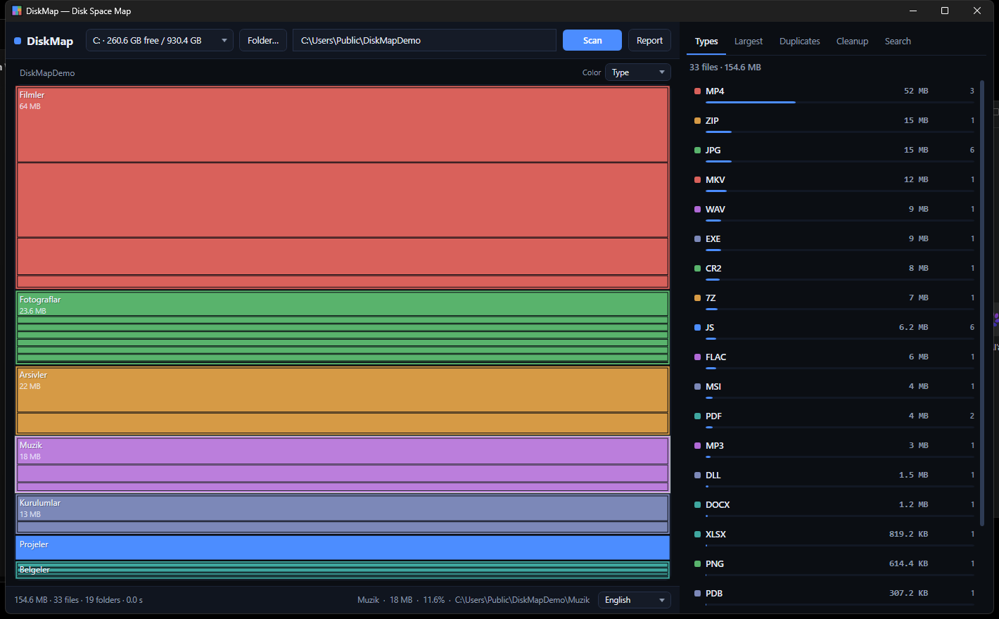

# DiskMap — Disk Space Map

**English** | [Türkçe](README.tr.md)

<p align="center">
  <a href="https://github.com/Whitich/DiskMap/releases/latest/download/DiskMap.exe">
    
  </a>
</p>

A fast, modern, safety-first disk space visualizer for Windows. Explore folders on
an interactive treemap, find large files, duplicates, developer leftovers, and
empty folders. The interface is available in English (default) and Turkish.



## Download

[**Download DiskMap.exe**](https://github.com/Whitich/DiskMap/releases/latest/download/DiskMap.exe)

This is the portable, self-contained single-file build for Windows 10/11 x64.
No installation and no separate .NET runtime are required. The build is unsigned,
so Windows SmartScreen may show a warning; choose **More info → Run anyway** if
you trust the build.

## Features

- Fast, parallel, and cancellable scanning
- Squarified treemap with up to three levels, double-click navigation, and breadcrumbs
- Three treemap color modes: file type, age, and size
- File type breakdown and largest-files list
- Content-based duplicate finder (size + 64 KB precheck + SHA-256)
- Cleanup scan for developer artifacts (`node_modules`, `bin`, `obj`, `__pycache__`…),
  temporary files, and empty folders
- Search by name, size, extension, and age
- Markdown and CSV report export
- Dark theme, English/Turkish UI with live language switching, and context menus
- Self-contained portable build

## Safety and privacy

DiskMap is designed to be read-only unless you explicitly choose to move something.

- **Scanning is fully read-only.** No file is changed while a folder is scanned.
- Nothing is deleted, moved, or renamed automatically.
- Duplicate and cleanup items are **unchecked by default**.
- Files are moved only after you select them and confirm the action.
- The confirmation dialog defaults to **Cancel**.
- Items are sent to the **Recycle Bin**, not permanently deleted.
- Operations are blocked on network/UNC paths, optical drives, scan roots, and
  volumes where the Recycle Bin is unavailable or disabled.
- The scanned root folder and its ancestors cannot be removed.
- No telemetry, network access, or background service.
- The app stores the last scan path in `%LOCALAPPDATA%\DiskMap\settings.txt` and
  the selected language in `%LOCALAPPDATA%\DiskMap\language.txt`.
- Reports are written only when you export them.

## Requirements

- Windows 10 or Windows 11 (x64)
- [.NET 10 SDK](https://dotnet.microsoft.com/download) to build from source
- Inno Setup 6 (optional, only for building the installer)

## Run from source

Build outputs are intentionally not committed to this repository.

Clone the repository and open PowerShell in its directory before building:

```powershell
git clone https://github.com/Whitich/DiskMap.git
cd DiskMap
```

```powershell
.\build.ps1
```

Outputs:

- `publish\DiskMap.exe` — portable, self-contained single-file executable
- `dist\DiskMap-Setup-1.0.0.exe` — Inno Setup installer

The installer is produced only when Inno Setup 6 is installed. If it is missing,
the script prints a warning and keeps the portable executable. Launch the
portable build with `.\publish\DiskMap.exe`.

To build only the portable executable:

```powershell
.\build.ps1 -SkipInstaller
```

The compiled setup is unsigned, so Windows SmartScreen may show a warning.
Use **More info → Run anyway** if you trust the build.

## Usage

1. Choose a drive or enter a folder path.
2. Select **Scan**.
3. Double-click a folder in the treemap to drill down; use the breadcrumb to go back.
4. Use the tabs on the right to inspect types, largest files, duplicates, and
   cleanup candidates.
5. Use the **Color** selector above the map to switch between type, age, and size.
6. Switch between English and Turkish from the language menu in the status bar.
   The selection is remembered for the next launch.
7. Select **Report** to export a Markdown or CSV report.

## Project structure

```text
DiskMap/
  Controls/       Treemap rendering and layout
  Localization/   English and Turkish UI strings
  Models/         File tree and list models
  Services/       Scanning, duplicates, cleanup, file operations, reports
  Themes/         Dark theme styles
  Util/           Formatting, color palettes, localization, settings
  installer/      Inno Setup script
  screenshots/    Screenshots
```

## License

MIT — see [LICENSE](LICENSE).

Copyright (c) 2026 Mert Harmankaşı.
