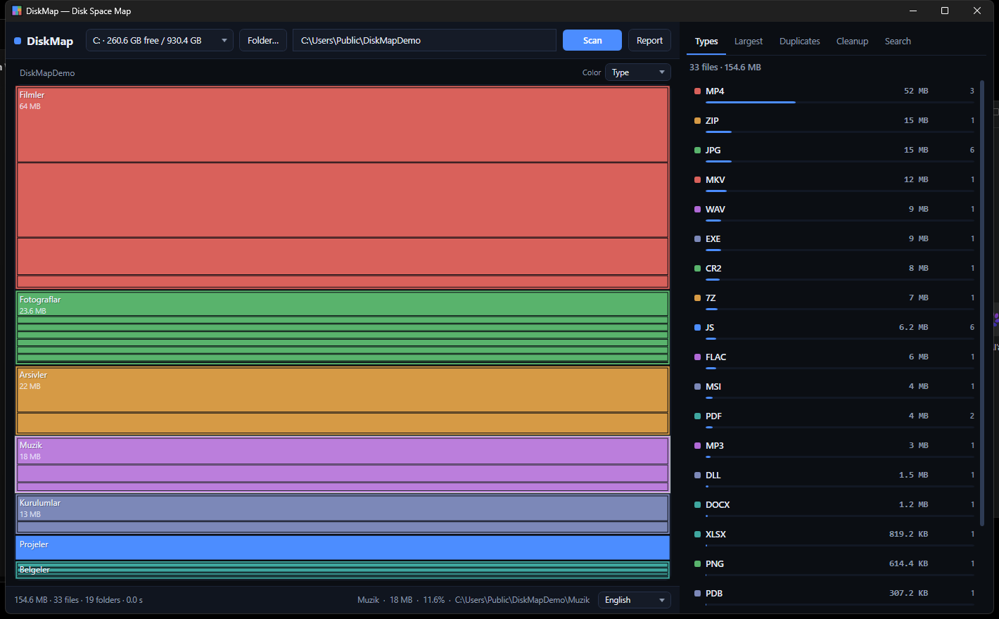

# DiskMap — Disk Alanı Haritası

[English](README.md) | **Türkçe**

Windows için hızlı, modern ve güvenli bir disk alanı görselleştiricisi. Klasörlerinizi
etkileşimli bir treemap üzerinde inceleyin; büyük dosyaları, kopyaları, geliştirici
artıklarını ve boş klasörleri bulun. Arayüz İngilizce (varsayılan) ve Türkçe olarak
kullanılabilir.



## Özellikler

- Hızlı, paralel ve iptal edilebilir tarama
- Üç seviyeye kadar squarified treemap, çift tıkla gezinme ve kırıntı yolu
- Üç treemap renk modu: dosya türü, yaş ve boyut
- Dosya türü dağılımı ve en büyük dosyalar listesi
- İçerik tabanlı kopya bulucu (boyut + 64 KB ön kontrol + SHA-256)
- Geliştirici artıkları (`node_modules`, `bin`, `obj`, `__pycache__`…), geçici
  dosyalar ve boş klasörler için temizlik taraması
- Ada, boyuta, uzantıya ve tarihe göre arama
- Markdown ve CSV rapor dışa aktarma
- Koyu tema, canlı dil değişimi destekli İngilizce/Türkçe arayüz ve bağlam menüleri
- Kendi kendine yeterli taşınabilir sürüm

## Güvenlik ve gizlilik

DiskMap, siz açıkça seçmedikçe hiçbir dosyayı taşımaz.

- **Tarama tamamen salt okunurdur.** Tarama sırasında hiçbir dosya değiştirilmez.
- Hiçbir dosya otomatik olarak silinmez, taşınmaz veya yeniden adlandırılmaz.
- Kopya ve temizlik öğeleri **varsayılan olarak seçili gelmez**.
- Dosyalar yalnızca siz seçtikten ve işlemi onayladıktan sonra taşınır.
- Onay penceresindeki varsayılan buton **Vazgeç**'tir.
- Öğeler kalıcı olarak silinmez; **Geri Dönüşüm Kutusu**'na taşınır.
- Ağ/UNC yollarında, optik sürücülerde, tarama kökünde ve Geri Dönüşüm Kutusu
  kullanılamayan birimlerde işlemler engellenir.
- Taranan kök klasör ve üst klasörleri kaldırılamaz.
- Telemetri, ağ erişimi veya arka plan servisi yoktur.
- Uygulama son tarama yolunu `%LOCALAPPDATA%\DiskMap\settings.txt`, seçili dili
  `%LOCALAPPDATA%\DiskMap\language.txt` dosyasında saklar.
- Raporlar yalnızca siz dışa aktardığınızda yazılır.

## Gereksinimler

- Windows 10 veya Windows 11 (x64)
- Kaynaktan derlemek için [.NET 10 SDK](https://dotnet.microsoft.com/download)
- Inno Setup 6 (isteğe bağlı, yalnızca kurulum dosyası için)

## Kaynaktan çalıştırma

Derleme çıktıları bu depoya bilerek eklenmez.

```powershell
.\build.ps1
```

Çıktılar:

- `publish\DiskMap.exe` — taşınabilir, kendi kendine yeterli tek dosya
- `dist\DiskMap-Setup-1.0.0.exe` — Inno Setup kurulum dosyası

Yalnızca taşınabilir sürümü üretmek için:

```powershell
.\build.ps1 -SkipInstaller
```

Kurulum dosyası imzasız olduğu için Windows SmartScreen uyarı gösterebilir.
Derlemeye güveniyorsanız **Ek bilgi → Yine de çalıştır** ile devam edebilirsiniz.

## Kullanım

1. Bir sürücü seçin veya klasör yolu girin.
2. **Tara**'ya basın.
3. Haritada bir klasöre çift tıklayarak içine girin; kırıntı yoluyla geri dönün.
4. Sağdaki sekmelerden türleri, en büyük dosyaları, kopyaları ve temizlik
   adaylarını inceleyin.
5. Haritanın üstündeki **Renk** menüsünden tür, yaş veya boyut görünümünü seçin.
6. Durum çubuğundaki dil menüsünden İngilizce/Türkçe arasında geçiş yapın.
   Seçim sonraki açılışta hatırlanır.
7. Markdown veya CSV rapor almak için **Rapor**'a basın.

## Proje yapısı

```text
DiskMap/
  Controls/       Treemap çizimi ve yerleşimi
  Localization/   İngilizce ve Türkçe arayüz metinleri
  Models/         Dosya ağacı ve liste modelleri
  Services/       Tarama, kopya, temizlik, dosya işlemleri, raporlar
  Themes/         Koyu tema stilleri
  Util/           Biçimlendirme, renk paletleri, yerelleştirme, ayarlar
  installer/      Inno Setup betiği
  screenshots/    Ekran görüntüleri
```

## Lisans

MIT — bkz. [LICENSE](LICENSE).

Telif hakkı (c) 2026 Mert Harmankaşı.
